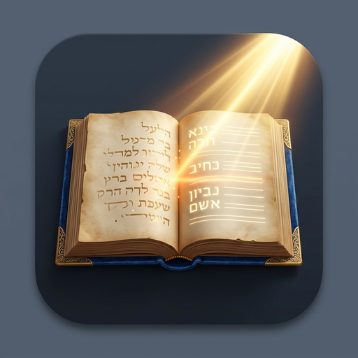

# Ohr HaKsav (אור הכתב) — v1.3.0
### Offline Torah Notes & Hebrew Handwriting OCR Studio
*דער קלוגער כתב-אויסלייגער פאר שיעורים און חידושי תורה • Light of the Script*

[](LICENSE)
[](https://github.com/aharonhakohen/TorahNotesOCR)
[](#key-features)
[](https://www.riverbankcomputing.com/software/pyqt/)
[](https://pytorch.org/)

---

<p align="center">
  
</p>

## 📖 Overview
**Ohr HaKsav (אור הכתב)** ("Light of the Script") is a standalone, **100% offline** desktop application built for yeshiva students, rebbeim, and Torah scholars. It empowers users to transcribe notebook photos containing handwritten Hebrew notes (both Ashkenazi/Sefardi cursive script and print), proofread them side-by-side with original manuscript images, and export formatted Right-to-Left Microsoft Word documents (`.docx`).

Ohr HaKsav features a **continuous self-learning memory engine**: as you correct misread letters and words in the proofreading editor and click **"🎓 Save & Learn Mistakes"**, the app registers your corrections into your local profile database and applies them to future scans, becoming smarter with every notebook digitized.

---

## ✨ Key Features in v1.3.0

1. **Complete Rebrand to "Ohr HaKsav" (אור הכתב)**
   - Elegant new radiant emblem featuring a beam of golden light illuminating an antique Torah manuscript and transforming cursive handwriting into clean Hebrew typography.
   - Polished branding across window titles, splash screens, setup wizards, uninstaller, and taskbar icons.
   - **Seamless Data Migration**: Existing learned user databases and profiles from `%APPDATA%\KsavKooker` are automatically migrated to `%APPDATA%\OhrHaKsav` upon initial launch.

2. **Refined, Distraction-Free Proofreading Studio**
   - **Clear Workflow Action**: Crystal-clear **"🎓 Save & Learn Mistakes"** button replacing ambiguous labels so proofreading and teaching the engine is intuitive.
   - **Distraction-Free Workspace**: The character/word/line counters at the bottom of the editor are tucked away by default and easily toggled via the menu bar (`View > Show Statistics & Details` or `Ctrl+Shift+S`).
   - **Interactive Workflow Guidance Card**: A clean dismissible helper card above the editor guides users on how to make changes and train the engine.

3. **High-Contrast Light Mode Default & Zero Text Clipping**
   - Clean, high-contrast light theme with rich navy blue accents, slate borders, and crisp black text designed for readability on high-DPI displays and projectors.
   - Dynamic button padding and minimum-width calculations eliminate text clipping and truncated button titles across all screen resolutions and DPI scaling factors.

4. **Interactive Hover ScreenTips**
   - Rich, explanatory tooltips appear when hovering over toolbar buttons and menus, explaining shortcut keys and exactly what each tool accomplishes.

5. **Multi-User Handwriting Profiles & Stacking**
   - **Isolated Profiles**: Create dedicated learning profiles for different scribes, students, or notebook styles stored locally in `%APPDATA%\OhrHaKsav\profiles\`.
   - **Multi-Profile Stacking**: Combine rules from multiple scribes simultaneously during OCR recognition.
   - **Preloaded Yeshiva Lexicon**: Recognizes over 50 common Talmudic abbreviations (*ראשי תיבות*) out of the box (רש"י, תוס', רמב"ם, ראב"ד, רי"ף, רא"ש, גמ', נפק"מ, קמ"ל, ח"נ, נ"ש, סד"א, ברה"ר, ברה"י, etc.).

6. **Backup, Restore & Knowledge Merging Center**
   - One-click timestamped profile backups (`.ohrhaksav`), safe restores with automatic pre-backup snapshots, rule merging, and JSON export/import.

7. **Domain-Aware Setup Wizard & Enterprise Offline Update Checker**
   - Multi-path shortcut creation detects active redirected desktop folders (`\\newltcserver\userdata$\...`) on Windows Server domain environments.
   - Built-in update manager under `Help > Check for Updates...` checks both official GitHub releases and offline local network shares (`\\newltcserver\Installs\OhrHaKsav` or Google Drive).

---

## 🚀 Quick Start Guide

### Option 1: Windows Setup Wizard (Recommended)
1. Download **`OhrHaKsav_Setup.exe`** from the [Releases](https://github.com/aharonhakohen/TorahNotesOCR/releases) page.
2. Run the installer and click **Next >** and **Install**.
3. Launch **Ohr HaKsav** from your Desktop or Start Menu.

### Option 2: Portable Zip
1. Download **`OhrHaKsav-v1.3.0-Windows.zip`**.
2. Unzip to any folder or USB flash drive.
3. Double-click **`OhrHaKsav.exe`**.

---

## 📝 User Workflow

```
[ Attach Pages ] ──> [ Select Profile ] ──> [ Rotate / Orient ] ──> [ ⚡ Scan OCR ] 
                                                                           │
                                                                           ▼
[ 📝 Export .docx ] <── [ 🎓 Save & Learn Mistakes ] <── [ Side-by-Side Proofread ]
```

1. **Attach Pages**: Click **"📁 Attach Pages"** or drag-and-drop notebook photos into the window.
2. **Select Profile**: Pick the author's handwriting profile from the **👤 Profile** dropdown.
3. **Rotate if needed**: If a photo was taken sideways, click **"↻ 90°"** to orient it upright.
4. **Scan (OCR)**: Click **"⚡ Scan Current Page"** (or **"⚡⚡ Scan All Pages"** for batch scans).
5. **Proofread & Correct**: Read through the transcription side-by-side with the original image, editing any misread words.
6. **Learn Mistakes**: Click **"🎓 Save & Learn Mistakes"**. The system immediately registers the correction into your active profile.
7. **Export**: Click **"📝 Export to Word"** to generate a formatted Right-to-Left Microsoft Word document.

---

## 🛠️ Developer Setup & Building from Source

### Prerequisites
- Python 3.10+ (64-bit)
- Git

### Installation
```bash
git clone https://github.com/aharonhakohen/TorahNotesOCR.git
cd TorahNotesOCR
python -m venv venv
venv\Scripts\activate
pip install -r requirements.txt
```

### Running from Source
```bash
python main.py
```

### Building the Standalone Installer
```bash
python build_exe.py
```

---

## 📄 License & Attribution
- Licensed under the [MIT License](LICENSE).
- Developed for Torah u'Mesorah Lakewood Teachers Center & the Yeshiva community.
